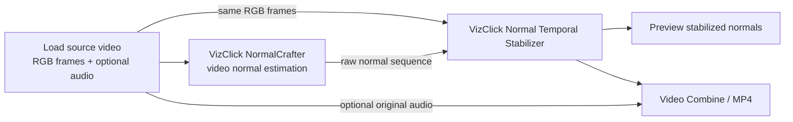
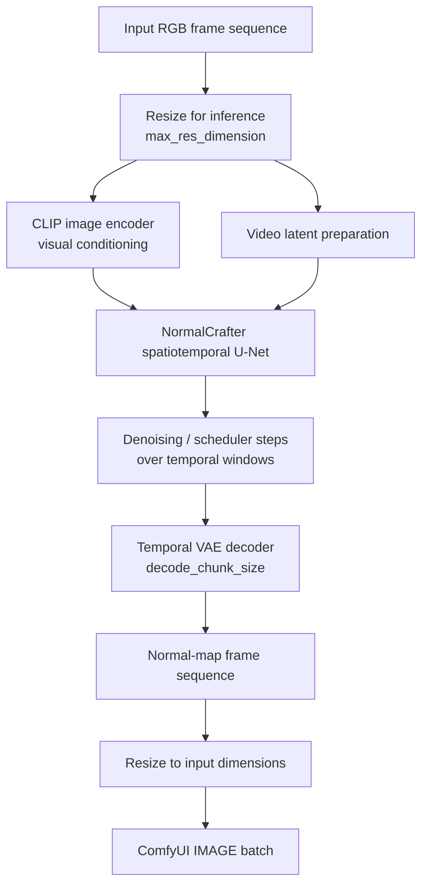
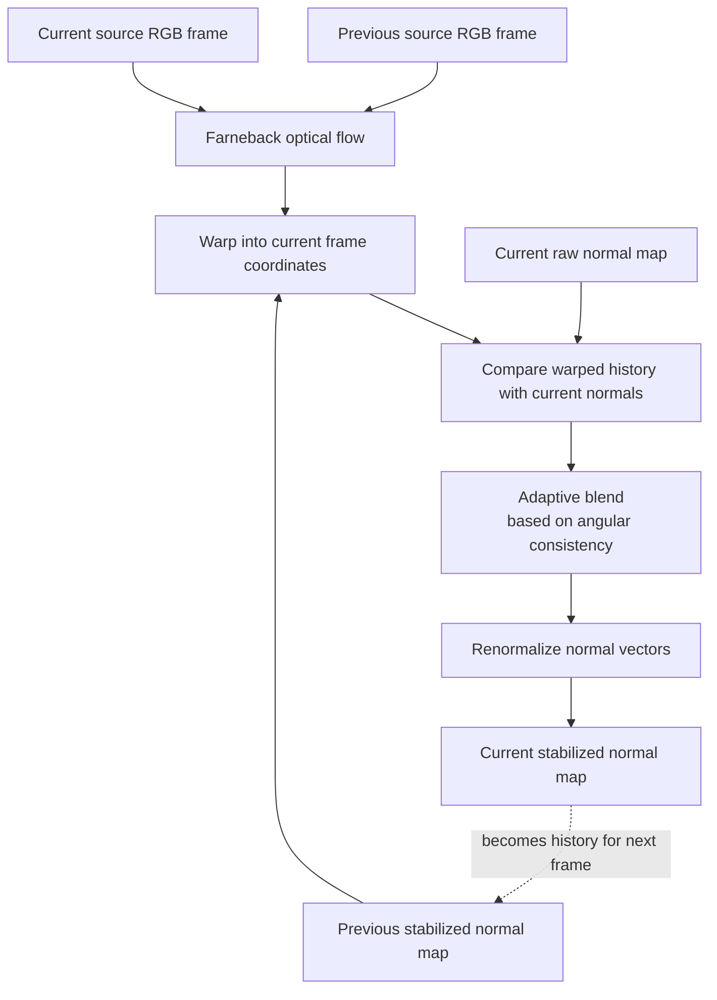

# ComfyUI-VizClick-NormalCrafter

**Video-to-normal-map estimation and motion-aware temporal stabilization for ComfyUI.**

VizClick NormalCrafter brings [NormalCrafter](https://github.com/Binyr/NormalCrafter), a research model for estimating temporally consistent surface-normal sequences from RGB video, into a ComfyUI workflow. The package also includes **VizClick Normal Temporal Stabilizer**, a complementary post-processing node that uses optical flow from the source video to reduce residual flicker while preserving real motion and changes in geometry.

> **The only separate model download is NormalCrafter.** The custom-node package includes the ComfyUI integration and the two upstream Python implementation files it uses. The stabilizer does not require a separate checkpoint. Internet access is needed on first use only if either bundled upstream Python file is missing and the node has to fetch it as a fallback.

- **Upstream project:** [Binyr/NormalCrafter](https://github.com/Binyr/NormalCrafter)
- **Model weights:** [Yanrui95/NormalCrafter on Hugging Face](https://huggingface.co/Yanrui95/NormalCrafter)
- **Paper:** [NormalCrafter: Learning Temporally Consistent Normals from Video Diffusion Priors](https://arxiv.org/abs/2504.11427)
- **Project page:** [normalcrafter.github.io](https://normalcrafter.github.io/)

---

## Contents

- [What this package does](#what-this-package-does)
- [How NormalCrafter works](#how-normalcrafter-works)
- [Architecture diagrams](#architecture-diagrams)
- [Installation](#installation)
- [Download and install the model](#download-and-install-the-model)
- [Run the example workflow](#run-the-example-workflow)
- [Node reference](#node-reference)
- [Performance and quality tips](#performance-and-quality-tips)
- [Troubleshooting](#troubleshooting)
- [Limitations and interpretation](#limitations-and-interpretation)
- [Credits and licensing](#credits-and-licensing)

## What this package does

A **surface normal map** encodes the estimated orientation of a surface at each pixel. In the usual RGB visualization, the red, green, and blue channels encode the X, Y, and Z components of a normal vector. Normal maps are useful for geometry-aware relighting, material and surface analysis, VFX, compositing, and other 3D-oriented workflows.

This package contains two nodes with different responsibilities:

### VizClick NormalCrafter

- Takes a batch of RGB frames from a ComfyUI `IMAGE` input.
- Runs the NormalCrafter video model to estimate a normal-map sequence.
- Processes temporal windows so longer clips can be handled by the upstream pipeline.
- Resizes frames for inference according to `max_res_dimension`, then resizes the output back to the input frame dimensions.
- Returns an `IMAGE` batch containing the generated normal maps, suitable for previewing, saving, or passing to other nodes.

### VizClick Normal Temporal Stabilizer

- Takes the original RGB frames and the generated normal-map sequence.
- Estimates frame-to-frame motion from the **source RGB video** using OpenCV Farnebäck optical flow.
- Warps the previous stabilized normal map into the current frame's coordinates.
- Blends that warped history with the current frame's normal estimate, with the blend weight adapted to angular agreement between the two.
- Renormalizes the blended normal vectors to keep them unit length.
- Returns a stabilized `IMAGE` batch.

The stabilizer is a post-processing stage; it does not run another neural network and does not need a second model download.

---

## How NormalCrafter works

NormalCrafter is a research method introduced in the paper *NormalCrafter: Learning Temporally Consistent Normals from Video Diffusion Priors* (ICCV 2025). Instead of estimating each frame independently, it adapts a video-diffusion prior to predict surface normals across a sequence. This helps it use temporal context as well as image appearance when estimating geometry.

The upstream work describes three important ideas:

1. **Video-diffusion prior.** NormalCrafter builds on a Stable Video Diffusion-style architecture, conditioned on the input RGB frames. A spatiotemporal U-Net operates on video latents and a VAE decoder reconstructs the output frames.
2. **Semantic Feature Regularization (SFR).** During training, diffusion features are aligned with semantic features from DINOv2. The paper uses this to encourage finer geometric detail rather than overly smooth predictions.
3. **Two-stage training.** The authors first train in latent space with diffusion and semantic regularization objectives, then fine-tune spatial detail in pixel space using an angular normal loss and semantic regularization.

SFR is a **training technique** described by the authors; this ComfyUI wrapper does not run a separate DINOv2 network at inference time. It loads the released NormalCrafter weights and the components required by the released inference pipeline.

### Inference components used by this integration

| Component | Role |
|---|---|
| CLIP image encoder | Encodes visual conditioning from the input frames. |
| NormalCrafter spatiotemporal U-Net | Predicts the video latent representation used to generate normal maps. |
| Temporal VAE decoder | Decodes latent video frames into image-space normal-map visualizations. |
| Euler discrete scheduler | Drives the diffusion sampling steps used by the upstream pipeline. |
| Temporal windows | Let the upstream pipeline process sequences longer than one window, with overlapping context. |

The model is estimating **surface orientation**, not a metric depth map. It does not directly output a mesh, camera calibration, world-space geometry, or physically measured distances.

---

## Architecture diagrams

GitHub renders the Mermaid diagrams below directly in the README.

### 1. End-to-end ComfyUI workflow



The source video has two paths: one goes into NormalCrafter to generate normals; the other goes into the stabilizer to estimate motion. The stabilizer's output is the recommended signal to preview and export when temporal stabilization is desired.

### 2. Simplified NormalCrafter model path



This is a conceptual diagram of the released inference path, not a complete reproduction of every internal tensor operation in the research implementation.

### 3. Motion-aware temporal stabilization



The source RGB frames guide motion estimation; they are **not blended into the normal map**. This is designed to avoid the appearance of motion blur in the normals. Temporal blending is reduced when the warped previous estimate disagrees with the current estimate, which can indicate a real surface change, occlusion, or unreliable correspondence.

---

## Installation

### Option A — ComfyUI Manager / Registry

1. Install **ComfyUI-VizClick-NormalCrafter** from the ComfyUI node registry/Manager, once the package is available there.
2. Restart ComfyUI after installation.
3. Download the model as described below.
4. Search the node menu for:
   - `VizClick NormalCrafter`
   - `VizClick Normal Temporal Stabilizer`

### Option B — Manual GitHub installation

Open a terminal in your ComfyUI custom-nodes directory and clone the repository:

```bash
cd ComfyUI/custom_nodes
git clone https://github.com/zuanfilm/ComfyUI-VizClick-NormalCrafter.git
```

If the repository is published under a different name or organization, replace the URL with the final repository URL.

Restart ComfyUI after cloning.

### Dependencies

The node uses the Python environment supplied by ComfyUI. Its declared Python dependencies are:

- `diffusers`
- `transformers`
- `accelerate`
- `opencv-python`

PyTorch is expected to come from the ComfyUI installation, including its compatible CUDA build when using an NVIDIA GPU. Avoid installing a different PyTorch/CUDA build into the ComfyUI environment unless you know it is compatible with your ComfyUI version.

Depending on the installation method and ComfyUI Registry metadata, dependencies may be installed automatically. If ComfyUI reports a missing package, install the package in the **same Python environment used to run ComfyUI** and restart it.

---

## Download and install the model

Download the complete model repository from:

**[NormalCrafter model on Hugging Face](https://huggingface.co/Yanrui95/NormalCrafter)**

Place the model directory here:

```text
ComfyUI/
└── models/
    └── NormalCrafter/
        ├── model_index.json
        ├── feature_extractor/
        ├── image_encoder/
        │   ├── config.json
        │   └── model.fp16.safetensors
        ├── scheduler/
        ├── unet/
        └── vae/
```

The tree above shows the component layout and the exact image-encoder filename checked by this node; it intentionally does not guess the weight filenames inside `unet/` or `vae/`. Download the full repository with every file and subfolder intact.

The names above illustrate the expected layout; **download the complete model repository with all files and subdirectories**, rather than downloading only the example weight files. Preserve the folder structure provided by Hugging Face. The node checks for `model_index.json`, `feature_extractor/preprocessor_config.json`, `image_encoder/config.json`, `image_encoder/model.fp16.safetensors`, `scheduler/scheduler_config.json`, `unet/config.json`, and `vae/config.json` before loading. The Hugging Face repository identifies the model as a Diffusers/Safetensors `StableVideoDiffusionPipeline` and lists the `feature_extractor`, `image_encoder`, `scheduler`, `unet`, and `vae` component directories. The repository is approximately 4.51 GB as listed on Hugging Face; allow for download and disk-space overhead. <https://huggingface.co/Yanrui95/NormalCrafter/tree/main>

The folder name is recognized in common capitalization variants (`NormalCrafter`, `Normalcrafter`, or `normalcrafter`). `NormalCrafter` is recommended for consistency.

No separate NormalCrafter Git clone is required. The custom-node package bundles `vendor/normalcrafter/normal_crafter_ppl.py` and `vendor/normalcrafter/unet.py`, so a normal installation does not need to download upstream Python code. As a fallback, if either file is absent, the node attempts to fetch the missing file from the upstream GitHub repository; internet access is required for that fallback to succeed. The model weights are distributed separately because of their size.

> **First-run note:** The model is loaded lazily when the node is first executed. The first run can take longer while components are loaded into memory. Ensure the complete model is present before running the workflow.

---

## Run the example workflow

Use the supplied workflow file:

**`workflows/Vizclick_NormalCrafter_adjusted.json`**

If the workflow is not included in your downloaded repository yet, use the corrected `Vizclick_NormalCrafter_adjusted.json` supplied with the project and save it in your workflows folder.

### Workflow steps

1. Load a source video using `VHS_LoadVideo` or another node that produces a ComfyUI `IMAGE` batch.
2. Connect the source frames to `VizClick NormalCrafter.images`.
3. Connect the same source frames to `VizClick Normal Temporal Stabilizer.source_images`.
4. Connect `VizClick NormalCrafter.normal_video` to `VizClick Normal Temporal Stabilizer.normal_video`.
5. Connect `stabilized_normals` to a preview node.
6. For an MP4 output, connect **`stabilized_normals`** to `VHS_VideoCombine.images`. Connect the original audio separately if you want to preserve it.

**Important:** Export the stabilizer's output if you want the saved video to include temporal stabilization. Exporting NormalCrafter's raw output bypasses that final stage.

### Suggested first test

Start with a short clip and the defaults in the example workflow:

- Maximum inference dimension: `512`
- Window size: `14`
- Time step size: `10`
- Decode chunk size: `4`
- Seed: `42`
- Offload after inference: enabled
- Temporal strength: `0.65`
- Motion strength: `1.0`
- Consistency threshold: `0.12`

Run a short clip first to confirm that the model loads and the full workflow completes before processing a long video.

---

## Node reference

### VizClick NormalCrafter

**Category:** `VizClick/Video/Geometry`  
**Input:** `images` — ComfyUI `IMAGE` batch in `[frames, height, width, channels]` layout, with RGB channels.  
**Output:** `normal_video` — generated normal-map sequence as an `IMAGE` batch.

| Parameter | Default | Range | What it does |
|---|---:|---:|---|
| `seed` | `42` | `0` to 64-bit unsigned maximum | Sets the random generator seed used by the inference pipeline. A fixed seed helps make runs reproducible when the software, model, hardware, and settings are unchanged. |
| `max_res_dimension` | `512` | `256–2048`, step `64` | Limits the longest input dimension used for inference. The integration resizes frames to dimensions aligned to multiples of 64 and then resizes output frames back to the original input dimensions. Higher values preserve more detail but generally use more memory and time. |
| `window_size` | `14` | `2–64` | Controls the temporal window size passed to the upstream pipeline. |
| `time_step_size` | `10` | `1–64` | Controls temporal window stepping/overlap in the upstream pipeline. Its interaction with `window_size` affects temporal context and compute; avoid assuming that larger values are always better. |
| `decode_chunk_size` | `4` | `1–64` | Number of frames decoded per VAE chunk. Smaller chunks can reduce peak decode memory at the cost of additional overhead. |
| `offload_after` | `true` | Boolean | After inference, asks the pipeline to move to CPU and clears the CUDA cache when available. This is a memory-management option; it does not change the normal-map algorithm. |

**Resolution behavior:** The node runs inference on resized frames and resizes generated normals back to the original source frame dimensions. Upscaling the output restores dimensions, not lost high-frequency details.

### VizClick Normal Temporal Stabilizer

**Category:** `VizClick/Video`  
**Inputs:**
- `source_images` — original RGB frames used only to estimate motion.
- `normal_video` — raw normal-map sequence from NormalCrafter.

**Output:** `stabilized_normals` — temporally stabilized normal-map sequence.

The node processes the number of frames available in both inputs, using the shorter batch length if they differ. Keep the two inputs aligned and in the same frame order for best results.

| Parameter | Default | Range | What it does |
|---|---:|---:|---|
| `temporal_strength` | `0.65` | `0.0–1.0` | Sets the maximum contribution from the warped previous stabilized frame. `0` disables temporal blending; larger values can reduce flicker but may introduce trailing or soften rapid changes if the motion estimate is unreliable. |
| `motion_strength` | `1.0` | `0.0–1.0` | Scales the estimated optical flow before warping the previous normal map. `1.0` uses the estimated flow at full strength; lower values reduce the displacement applied. |
| `consistency_threshold` | `0.12` | `0.01–0.50` | Controls how quickly temporal blending is reduced as the current normal estimate disagrees angularly with the warped history. Smaller values are more selective; larger values permit blending across greater disagreement. |

#### How the adaptive blend behaves

The stabilizer converts each normal visualization from RGB `[0, 1]` to a vector representation in `[-1, 1]` and normalizes the vectors. For each frame after the first, it:

1. Estimates dense optical flow between consecutive source RGB frames using Farneback flow.
2. Warps the previous stabilized normal vectors into the current frame's coordinates.
3. Measures angular disagreement between the warped vectors and the current raw normal vectors.
4. Uses that disagreement to reduce temporal influence where the estimates differ.
5. Blends the two vector fields and normalizes the result again.

Conceptually, the output is a consistency-weighted blend of the current normal estimate and the motion-compensated prior estimate. The implementation uses a Gaussian-like consistency weight derived from angular error; it is not a simple fixed-opacity blend across the entire image.

**Tuning advice:** Begin with `temporal_strength = 0.35–0.65` for a balanced result. Increase it only when residual flicker is more distracting than the risk of temporal lag. Use a lower `consistency_threshold` when genuine geometry changes need to be preserved more aggressively. These are starting points, not universal optimal values.

---

## Performance and quality tips

- **Start at 512.** It is a useful baseline for testing. Increase `max_res_dimension` only when the additional detail is worth the extra compute and memory.
- **Use short clips while tuning.** Long videos multiply inference time and memory pressure.
- **Reduce `decode_chunk_size` if decoding runs out of memory.** This primarily affects VAE decoding, not the full model's total memory requirement.
- **Keep source and normal sequences synchronized.** Both inputs to the stabilizer must represent the same frames in the same order.
- **Tune stabilization after model quality.** Temporal stabilization can reduce residual flicker; it cannot repair incorrect normals or recover details the estimator did not produce.
- **Expect motion-estimation limits.** Optical flow may be unreliable with motion blur, very low texture, large disocclusions, rapid cuts, flashes, or large changes between frames.
- **Memory varies by environment.** GPU model, driver, PyTorch/CUDA build, input dimensions, clip length, and offloading behavior all affect peak memory. The upstream project reports roughly 6 GB for a low-resolution 512 × 256 inference example and around 20 GB for 1024 × 576; these are upstream reference figures, not guarantees for every ComfyUI setup.

---

## Troubleshooting

### The node says the model is incomplete

- Confirm the model is in `ComfyUI/models/NormalCrafter/`.
- Confirm you downloaded the complete model repository and preserved its subfolders.
- Check that `model_index.json`, `unet/config.json`, `vae/config.json`, `scheduler/scheduler_config.json`, and `image_encoder/model.fp16.safetensors` exist.
- Restart ComfyUI after moving or downloading model files.

### `diffusers`, `transformers`, `accelerate`, or `cv2` cannot be imported

Install the missing dependency into the Python environment used by ComfyUI, not a separate system Python. Restart ComfyUI after installation. For `cv2`, the declared package is `opencv-python`.

### CUDA out-of-memory

- Lower `max_res_dimension`.
- Lower `decode_chunk_size`.
- Process a shorter clip while testing.
- Close other GPU-heavy workflows or applications.
- Enable `offload_after` to request CPU offloading after inference. This setting does not necessarily lower the peak memory needed during model execution.

### The stabilized output has trails or seems slow to react

- Reduce `temporal_strength`.
- Reduce `consistency_threshold` so blending falls off more quickly when normals disagree.
- Check that the source RGB frames match the normal sequence frame-for-frame.
- Be cautious with fast cuts, occlusions, motion blur, or large camera/object movement, where optical flow may be inaccurate.

### The output looks noisy or geometrically wrong

The stabilizer is not a geometry-correction model. Inspect the raw NormalCrafter output first. Try a different clip, a suitable inference resolution, or the model's recommended settings before increasing temporal blending.

### The MP4 contains raw rather than stabilized normals

Make sure `VHS_VideoCombine.images` is connected to **`VizClick Normal Temporal Stabilizer.stabilized_normals`**, not directly to `VizClick NormalCrafter.normal_video`.

---

## Limitations and interpretation

- Normal maps are an estimate of surface orientation, not ground-truth geometry.
- The RGB color channels are a visualization of vector components; do not treat the result as ordinary color footage.
- The temporal stabilizer assumes the two input sequences are synchronized and spatially corresponding.
- Optical flow can fail around occlusions, motion blur, cuts, textureless regions, reflections, and non-rigid motion. Adaptive consistency reduces—but cannot eliminate—the resulting artifacts.
- Resizing an output back to the source resolution does not restore detail lost during lower-resolution inference.
- The current integration returns normal-map images as a ComfyUI `IMAGE` batch. It does not create a mesh or automatically convert normals into depth, displacement, or world-space coordinates.

## Credits and licensing

### NormalCrafter research and source code

This integration builds on the work by Yanrui Bin, Wenbo Hu, Haoyuan Wang, Xinya Chen, and Bing Wang:

> Yan, B., Hu, W., Wang, H., Chen, X., & Wang, B. (2025). *NormalCrafter: Learning Temporally Consistent Normals from Video Diffusion Priors.* Proceedings of the IEEE/CVF International Conference on Computer Vision (ICCV).

- [Paper](https://arxiv.org/abs/2504.11427)
- [Official source repository](https://github.com/Binyr/NormalCrafter)
- [Official project page](https://normalcrafter.github.io/)

The upstream NormalCrafter source repository is marked **MIT**. The released model repository on Hugging Face is marked **Apache-2.0**. Review the license files and applicable terms in the exact upstream source and model repositories before redistributing upstream code or weights. This ComfyUI integration does not bundle the model weights.

The original VizClick integration code is licensed under **Apache-2.0**; see [`LICENSE.txt`](LICENSE.txt). The vendored upstream Python implementation retains its **MIT** license; see [`vendor/normalcrafter/LICENSE.txt`](vendor/normalcrafter/LICENSE.txt). Model weights are not included and remain subject to the terms shown in the model repository.

VizClick NormalCrafter and VizClick Normal Temporal Stabilizer are ComfyUI integrations developed for this package; they are not official components of the upstream NormalCrafter project and are not endorsed by its authors.

### Citation

If you use the NormalCrafter research model in academic work, please cite the original paper:

```bibtex
@InProceedings{Bin_2025_ICCV,
  author    = {Bin, Yanrui and Hu, Wenbo and Wang, Haoyuan and Chen, Xinya and Wang, Bing},
  title     = {NormalCrafter: Learning Temporally Consistent Normals from Video Diffusion Priors},
  booktitle = {Proceedings of the IEEE/CVF International Conference on Computer Vision (ICCV)},
  year      = {2025},
  pages     = {8330--8339}
}
```

---

**Made for ComfyUI by [zuanfilm](https://github.com/zuanfilm).**
